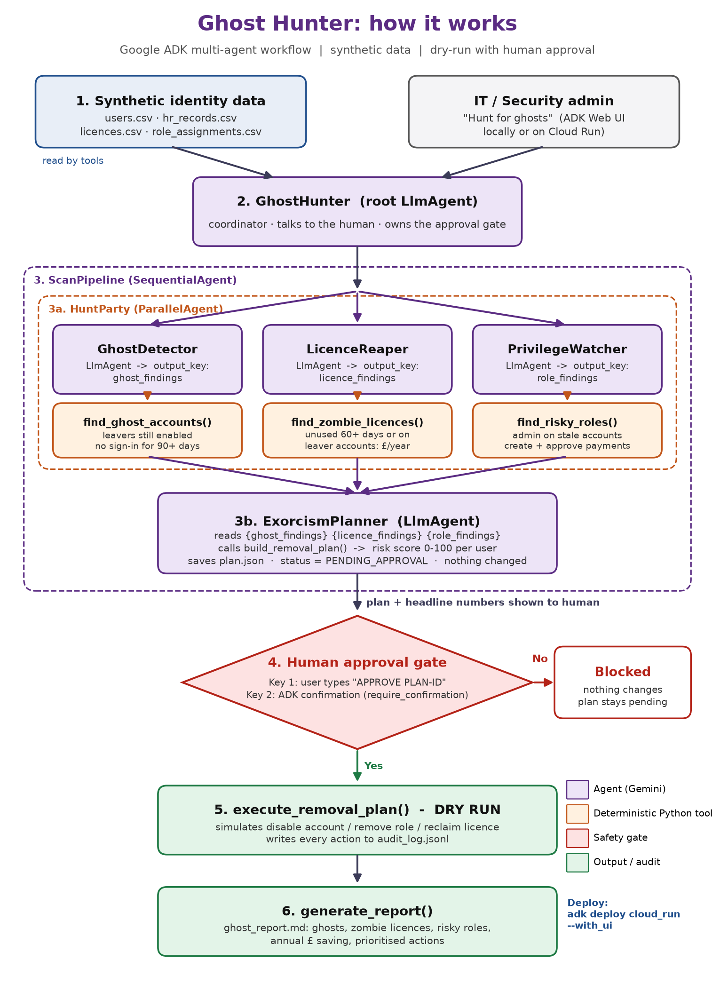

# 👻 Ghost Hunter

**A Google ADK multi-agent system that finds the ghosts haunting your company's IT: ex-employees who can still log in, paid licences nobody uses, and risky admin access. Then it proposes a safe, human-approved clean-up plan.**

Built for the AI DevCamp 2026 Agentic AI Hackathon (GDG London).



---

## The problem

When people leave a company, their accounts often stay switched on. Licences keep getting paid for. Admin rights stay with people who no longer need them. Each of these is a security hole and a waste of money, and checking them by hand takes IT teams days.

## What Ghost Hunter finds (on our demo data)

| Finding | Result |
|---|---|
| 👻 Ghost accounts (leavers who can still log in, or no sign-in for 90+ days) | **16** |
| 🧟 Zombie licences (paid but unused, or assigned to leavers) | **47** |
| ⚠️ Risky roles (admin on stale accounts, toxic role combinations) | **8** |
| 💰 Potential annual saving | **£12,950** |

## How it works

```
GhostHunter (root agent, talks to the human)
   └── ScanPipeline (SequentialAgent)
         ├── HuntParty (ParallelAgent, 3 hunters at the same time)
         │     ├── GhostDetector     → find_ghost_accounts
         │     ├── LicenceReaper     → find_zombie_licences
         │     └── PrivilegeWatcher  → find_risky_roles
         └── ExorcismPlanner → build_removal_plan (risk score 0-100 per user)
   ├── execute_removal_plan  (only after human approval, DRY RUN + audit log)
   └── generate_report       (Markdown report)
```

**The AI explains and prioritises, Python does the maths, and a human approves.**

## Safety

- **Two-key approval:** the user must type `APPROVE <plan_id>` exactly, and ADK also shows a confirmation pop-up
- **Dry run only:** nothing real is changed; every action is written to `output/audit_log.jsonl`
- **Synthetic data:** all names are invented and all emails use `example.com`
- **API key** stays in `ghost_hunter/.env`, which is never uploaded

## How to run it (Windows)

You need Python 3.10–3.13 and a Gemini API key from [Google AI Studio](https://aistudio.google.com/apikey).

```powershell
# 1. Create and switch on a virtual environment
python -m venv .venv
.venv\Scripts\activate

# 2. Install Google ADK
python -m pip install -r requirements.txt

# 3. Create your settings file, then open it and paste your API key
copy ghost_hunter\.env.example ghost_hunter\.env

# 4. Start the web interface
adk web --session_service_uri memory:// .
```

On Mac or Linux, use `source .venv/bin/activate` and `cp` instead of `copy`.

Open http://127.0.0.1:8000, choose **ghost_hunter**, and type:

1. `Hunt for ghosts`
2. `APPROVE PLAN-XXXXXX` (use the plan ID it gives you)
3. `Generate the report` (saved to `output/ghost_report.md`)

To make fresh fake data: `python generate_data.py`

Full guide: [docs/Ghost_Hunter_Guide.md](docs/Ghost_Hunter_Guide.md)

## What's next

- Connect to real Microsoft Entra ID / Google Workspace (read-only first)
- Scheduled weekly hunts with a summary sent to the IT team
- Real (non-dry-run) actions behind manager approval

## Team

- Diya Kapoor
- Nabiha Kulsum