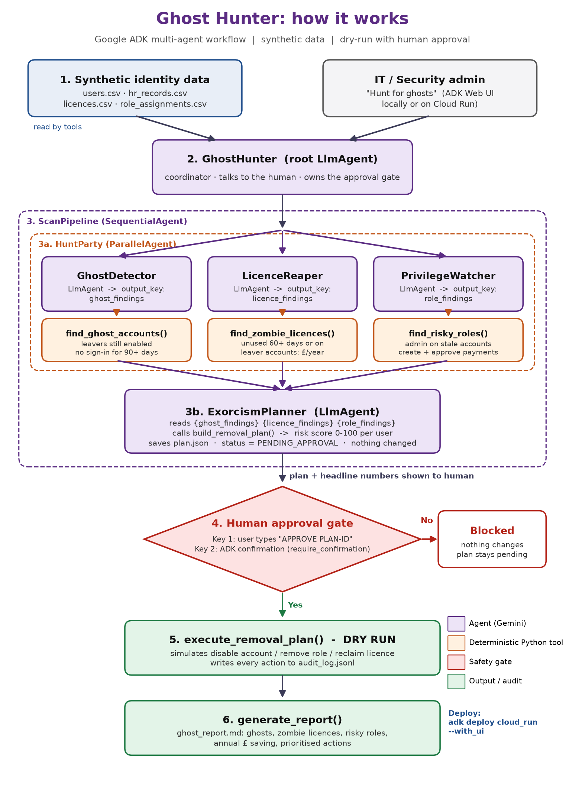
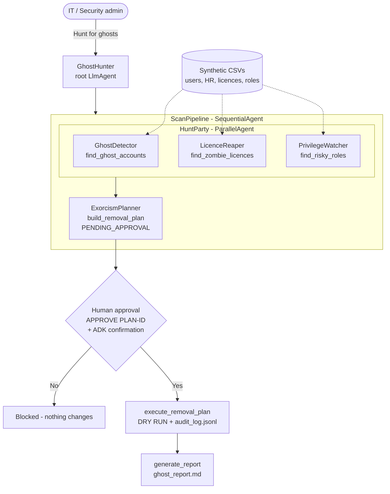

# Ghost Hunter: project guide

An agent built with Google ADK that hunts for ghost accounts, zombie licences and risky access, then proposes a clean-up plan that a human must approve.

Built for the GDG London AI DevCamp Agentic Hackathon (Halloween Hack), 31 October 2026.



---

## 1. The project in one paragraph

Most organisations have ghosts. These are people who left months ago but can still log in, paid licences nobody uses, and admin rights nobody remembers granting. Access reviews usually happen once a year, by hand, in spreadsheets. Ghost Hunter is a multi-agent system built with Google ADK. Three specialist agents scan identity, HR, licence and role data at the same time. A planner agent combines their findings into a risk-scored clean-up plan with a £ saving. Nothing is changed until a human approves the plan, and even then the demo only does a dry run and writes every action to an audit log.

## 2. Problem, audience and impact

| | |
|---|---|
| Problem | Leftover accounts are a well-known way attackers get in. Unused licences waste budget. "Create and approve payments" held by one person breaks segregation of duties. |
| Audience | IT, security and compliance teams in small and mid-sized organisations that can't afford enterprise identity governance tools |
| Today | A manual quarterly or annual review by exporting CSVs from HR, the identity provider and the licensing portal, then comparing them in Excel |
| With Ghost Hunter | A scan in about a minute, prioritised actions, the £ saving, a human approval step and an audit trail |
| Demo result (synthetic data, 60 users) | 16 ghost accounts, 47 zombie licences (£12,950 a year), 8 risky role assignments, 71 proposed actions across 36 users |

## 3. How it meets the judging criteria

| Criterion | How Ghost Hunter answers it |
|---|---|
| Impact | It solves a real security and cost problem for a clear audience (IT and security teams) and puts a £ figure on it |
| Technical depth | Uses `SequentialAgent`, `ParallelAgent`, `AgentTool`, state passed between agents through `output_key`, deterministic Python tools, ADK tool confirmation (human in the loop) and deployment to Cloud Run |
| Demo clarity | One prompt gives the headline numbers. One approval gives the audit log and report. You can show all of it in about 90 seconds |
| Originality | Identity hygiene with a Halloween theme. No other project on the portal covers access governance or licence waste |
| Rules | Synthetic data only (example.com emails), dry-run execution, an approval gate with two checks |
| Avoided project types | It isn't RAG, a prompt wrapper, a vision analyser, a chatbot or medical advice. It takes actions, and those actions are gated |

## 4. Architecture

| Step | Component | ADK type | What it does |
|---|---|---|---|
| 1 | Synthetic data | CSV files | `users.csv`, `hr_records.csv`, `licences.csv`, `role_assignments.csv` |
| 2 | GhostHunter | Root `LlmAgent` | Talks to the human, calls the scan, owns the approval step |
| 3 | ScanPipeline | `SequentialAgent` (wrapped in `AgentTool`) | Runs the hunters, then the planner |
| 3a | HuntParty | `ParallelAgent` | Runs three hunters at the same time |
| 3a | GhostDetector | `LlmAgent` + `find_ghost_accounts()` | Finds leavers whose accounts are still enabled, and accounts with no sign-in for 90+ days |
| 3a | LicenceReaper | `LlmAgent` + `find_zombie_licences()` | Finds licences on leaver accounts or unused for 60+ days, and the annual £ waste |
| 3a | PrivilegeWatcher | `LlmAgent` + `find_risky_roles()` | Finds admin roles on stale accounts, admin roles outside IT, and people who can both create and approve payments |
| 3b | ExorcismPlanner | `LlmAgent` + `build_removal_plan()` | Gives each user a risk score from 0 to 100, saves `plan.json` with status PENDING_APPROVAL |
| 4 | Approval gate | Typed phrase + `FunctionTool(require_confirmation=...)` | Key 1: the user types `APPROVE PLAN-ID`. Key 2: ADK asks for confirmation |
| 5 | Executor | `execute_removal_plan()` | Dry run only. Writes every action to `audit_log.jsonl` |
| 6 | Reporter | `generate_report()` | Writes `ghost_report.md` |

Design principle to say in the pitch: **"The AI explains and prioritises, Python decides, and a human approves."** All counts, £ figures and risk scores come from fixed Python code, so the AI can't make up a ghost.

### Text version of the flow (Mermaid)



## 5. Repository structure

```
ghost-hunter/
├── ghost_hunter/            # the ADK agent package (folder name = app name in adk web)
│   ├── __init__.py          # from . import agent
│   ├── agent.py             # root_agent + sub-agents
│   ├── tools.py             # deterministic detection, planning, dry-run execution, report
│   └── .env.example         # copy to .env and add your Gemini API key
├── data/                    # synthetic CSVs (created by generate_data.py)
├── output/                  # plan.json, audit_log.jsonl, ghost_report.md (git-ignored)
├── docs/                    # this guide + flowchart
├── generate_data.py         # makes 60 fake users with a fixed random seed (same output every run)
├── requirements.txt
└── README.md
```

The full, tested code is in the `ghost-hunter.zip` that comes with this guide.

---

## 6. Step-by-step build guide

### Step 0: before you arrive (on the train, 10 minutes)

1. Get a Gemini API key at [Google AI Studio](https://aistudio.google.com/apikey).
2. Create an empty public GitHub repo called `ghost-hunter`.
3. Register on the [hackathon portal](https://aidevcamp.gdg.london/hackathon) and join the hackathon (separate from your Luma ticket).
4. Read section 9 (the pitch) twice.

### Step 1: set up the environment (9:00–9:20)

```bash
unzip ghost-hunter.zip && cd ghost-hunter
python -m venv .venv
# Windows: .venv\Scripts\activate     macOS/Linux: source .venv/bin/activate
pip install -r requirements.txt
cp ghost_hunter/.env.example ghost_hunter/.env    # Windows: copy ghost_hunter\.env.example ghost_hunter\.env
```

Open `ghost_hunter/.env` and paste your key:

```
GOOGLE_GENAI_USE_ENTERPRISE=0
GOOGLE_API_KEY=your-key-here
GHOST_MODEL=gemini-3.5-flash
GHOST_CONFIRM_POPUP=1
```

If the model name gives an error, change `GHOST_MODEL` to `gemini-2.5-flash`.

### Step 2: generate the synthetic data (9:20–9:25)

```bash
python generate_data.py
# Wrote 60 users, 121 licences, 77 role assignments to .../data
```

Invented names with spooky surnames (Hollow, Graves, Raven and so on), `@example.com` emails, and a fixed seed so the numbers are the same every run.

### Step 3: understand the tools (9:25–9:45)

`ghost_hunter/tools.py` holds the rules. Change them if you like, but keep them deterministic:

| Function | Rule |
|---|---|
| `find_ghost_accounts()` | HR says Leaver **and** account is Enabled → High. Enabled with no sign-in for 90+ days → Medium |
| `find_zombie_licences()` | Licence on a leaver or disabled account, or not used for 60+ days. Annual cost = monthly cost × 12 |
| `find_risky_roles()` | Global Administrator on a ghost account → Critical. Global Administrator outside IT → High. Payment Creator + Payment Approver → High |
| `build_removal_plan()` | Points: Critical 40, High 25, Medium 10, each zombie licence 5, capped at 100. Saves `output/plan.json` |
| `execute_removal_plan(plan_id, approval_phrase)` | Refuses unless `approval_phrase == "APPROVE <plan_id>"`. Dry run only, adds each action to `audit_log.jsonl` |
| `generate_report()` | Writes `output/ghost_report.md` |

Quick check without the AI:

```bash
python -c "from ghost_hunter import tools as t; print(t.build_removal_plan()['annual_saving_gbp'])"
# 12950.4
```

### Step 4: understand the agents (9:45–10:15)

The core of `ghost_hunter/agent.py`:

```python
from google.adk.agents import LlmAgent, ParallelAgent, SequentialAgent
from google.adk.tools import FunctionTool
from google.adk.tools.agent_tool import AgentTool

ghost_detector    = LlmAgent(name="GhostDetector",    model=MODEL, tools=[t.find_ghost_accounts],  output_key="ghost_findings",   instruction="...")
licence_reaper    = LlmAgent(name="LicenceReaper",    model=MODEL, tools=[t.find_zombie_licences], output_key="licence_findings", instruction="...")
privilege_watcher = LlmAgent(name="PrivilegeWatcher", model=MODEL, tools=[t.find_risky_roles],     output_key="role_findings",    instruction="...")

hunt_party = ParallelAgent(name="HuntParty", sub_agents=[ghost_detector, licence_reaper, privilege_watcher])

planner = LlmAgent(name="ExorcismPlanner", model=MODEL, tools=[t.build_removal_plan],
    instruction="Ghosts: {ghost_findings} Licences: {licence_findings} Roles: {role_findings} ... call build_removal_plan ...")

scan_pipeline = SequentialAgent(name="ScanPipeline", sub_agents=[hunt_party, planner])

root_agent = LlmAgent(name="GhostHunter", model=MODEL, instruction="...",
    tools=[AgentTool(agent=scan_pipeline),
           FunctionTool(t.execute_removal_plan, require_confirmation=CONFIRM_POPUP),
           t.generate_report])
```

How it fits together:

- **`output_key`**: each hunter saves its summary into session state, and the planner reads it through `{ghost_findings}` and the other placeholders in its instructions.
- **`ParallelAgent`**: the three hunters run at the same time.
- **`SequentialAgent`**: makes sure the planner only runs after all three hunters have finished.
- **`AgentTool`**: lets the root agent call the whole pipeline as one tool, so the root stays in charge of the conversation and the approval step.
- **`require_confirmation`**: ADK pauses before running the tool and asks the human to confirm. This is the second approval check.

### Step 5: run it locally (10:15–10:45)

Run this from the `ghost-hunter` folder (the folder that contains `ghost_hunter/`):

```bash
adk web --session_service_uri memory:// .
```

Open http://localhost:8000, choose **ghost_hunter** in the dropdown, then try:

1. `Hunt for ghosts` → see the parallel hunters, the planner and the headline numbers
2. `Execute the plan` (without the phrase) → it should refuse and ask for `APPROVE PLAN-XXXXXX`
3. `APPROVE PLAN-XXXXXX` → the ADK confirmation appears → confirm → dry run, audit log written
4. `Generate the report` → `output/ghost_report.md`

Use the **Events / Trace** tab in ADK Web during the demo. It shows the agents and tool calls visually, which is good for the technical-depth score.

`memory://` is there because ADK's tool confirmation is experimental and doesn't support database session services.

### Step 6: test and adjust (10:45–12:00)

- Run the full flow three times and make sure the numbers match each time.
- Adjust the hunter instructions if the answers are too long. Ask for "max 6 bullet points".
- Write down the exact prompts you'll use live in a text file so you can paste them during the demo.
- If the confirmation pop-up misbehaves: set `GHOST_CONFIRM_POPUP=0` in `.env`. The typed phrase still blocks execution.

### Step 7: push to GitHub (12:00–12:15)

```bash
git init && git add . && git commit -m "Ghost Hunter: ADK multi-agent identity hygiene"
git branch -M main
git remote add origin https://github.com/<your-username>/ghost-hunter.git
git push -u origin main
```

`.env` and `output/` are already in `.gitignore`, so your API key won't be pushed. Check this on GitHub after pushing.

### Step 8: deploy to Cloud Run (12:15–13:15, optional but scores well)

You need a Google Cloud project with billing enabled and `gcloud` installed and signed in.

```bash
gcloud auth login
gcloud config set project YOUR_PROJECT_ID
adk deploy cloud_run --project=YOUR_PROJECT_ID --region=europe-west2 --with_ui \
  --env GOOGLE_API_KEY=YOUR_KEY --env GOOGLE_GENAI_USE_ENTERPRISE=0 ./ghost_hunter
```

Before deploying, copy `data/` inside `ghost_hunter/` so it gets uploaded. In `tools.py`, change `DATA = ROOT / "data"` to `DATA = Path(__file__).resolve().parent / "data"`. Keep `OUT` pointing to a writable folder such as `Path("/tmp/output")`.

If deployment isn't finished by 13:15, stop and demo locally. A working local demo is worth more than a broken cloud link.

### Step 9: submit (by 14:00 at the latest, then update)

Submit on the portal's My projects page with:

1. A working project (local demo plus Cloud Run link if deployed)
2. A demo video under 3 minutes. Record your screen running steps 1 to 4 from Step 5. This is your backup if the Wi-Fi fails
3. A description (problem, idea, how it works). Copy sections 1, 2 and 4 of this guide
4. The GitHub repo link
5. Screenshots: the flowchart, ADK Web trace, the plan and the report

Submit a draft around 13:00, then update it. Never leave submission until 14:55.

---

## 7. Safety and responsible AI

- Synthetic data only. Names are invented and emails use `example.com`.
- The AI never decides alone. Detection and scoring are fixed Python rules that you can explain and check.
- Two-key approval. The user types the exact phrase, and ADK asks for confirmation.
- Dry run by default. No connection to a real identity provider. Every action is logged with a timestamp and plan ID.
- In production: connect read-only first (Microsoft Graph or Google Workspace Admin APIs through MCP), keep write actions behind approval, and use least-privilege service accounts.

## 8. Roadmap (for the "what's next" slide)

1. MCP connectors for Microsoft Entra ID / Graph, Google Workspace and Okta
2. A scheduled monthly scan that emails a report to the security team (with an approval link)
3. Manager attestations: send each manager their team's proposed changes to approve
4. Map findings to ISO 27001 and Cyber Essentials access-control controls for audit evidence

## 9. Pitch and live demo script (3 minutes)

| Time | What you say / do |
|---|---|
| 0:00–0:20 | Hook: "It's Halloween, so let's talk about ghosts. Every company has them: people who left months ago but can still log in, and licences we keep paying for. I built Ghost Hunter to find them." |
| 0:20–0:45 | Problem: "Access reviews are manual, yearly and done in spreadsheets. Leftover accounts are a well-known way attackers get in, and unused licences waste money every month." |
| 0:45–2:00 | Live demo: type `Hunt for ghosts`. Show the trace: three hunters running at the same time, then the planner. Read the headline: "16 ghosts, 47 zombie licences, about £13,000 a year, 8 risky roles." Type `Execute the plan` → it refuses. Type `APPROVE PLAN-…` → confirmation → dry run → audit log → report. |
| 2:00–2:35 | How it works: show the flowchart. "Sequential and parallel ADK agents. The AI explains and prioritises, Python decides, and a human approves. Synthetic data, dry run, full audit trail." |
| 2:35–3:00 | Next steps: "Next, MCP connectors to Entra ID and Google Workspace, and monthly scheduled scans. Ghost Hunter: who you gonna call?" |

### Likely judge questions

| Question | Answer |
|---|---|
| Why not just one prompt? | Each hunter has its own tool and focus. They run at the same time, and the planner needs all three results. Keeping detection in fixed code means the AI can't make up findings. |
| What stops the AI from approving itself? | The tool refuses unless the exact phrase came from the user, and ADK adds a separate confirmation step. Even then it's a dry run. |
| How would it work on real data? | Swap the CSV readers for read-only Microsoft Graph or Google Admin API calls through MCP. The agents and the approval step stay the same. |
| How is the £ saving calculated? | Licence monthly cost × 12 for every zombie licence. It's fixed Python code in `find_zombie_licences()`. |

## 10. Troubleshooting

| Problem | Fix |
|---|---|
| `adk: command not found` | Activate the virtual environment, or run `python -m google.adk.cli web --session_service_uri memory:// .` |
| Agent not in the dropdown | Run `adk web` from the folder that **contains** `ghost_hunter/`, not from inside it |
| Model not found / 404 | Set `GHOST_MODEL=gemini-2.5-flash` in `.env` |
| 429 / quota errors | Wait 30 seconds, or use a second API key. Your backup video covers the pitch |
| Confirmation pop-up stuck | Set `GHOST_CONFIRM_POPUP=0`. The typed approval phrase still protects execution |
| `FileNotFoundError: plan.json` | Run a scan before executing or generating the report |
| Numbers changed | Re-run `python generate_data.py` (fixed seed) |

## 11. References

- [Google ADK documentation](https://google.github.io/adk-docs/)
- [ADK parallel agents](https://google.github.io/adk-docs/agents/workflow-agents/parallel-agents/)
- [ADK tool confirmation (human in the loop)](https://google.github.io/adk-docs/tools-custom/confirmation/)
- [AI DevCamp hackathon portal](https://aidevcamp.gdg.london/hackathon)
